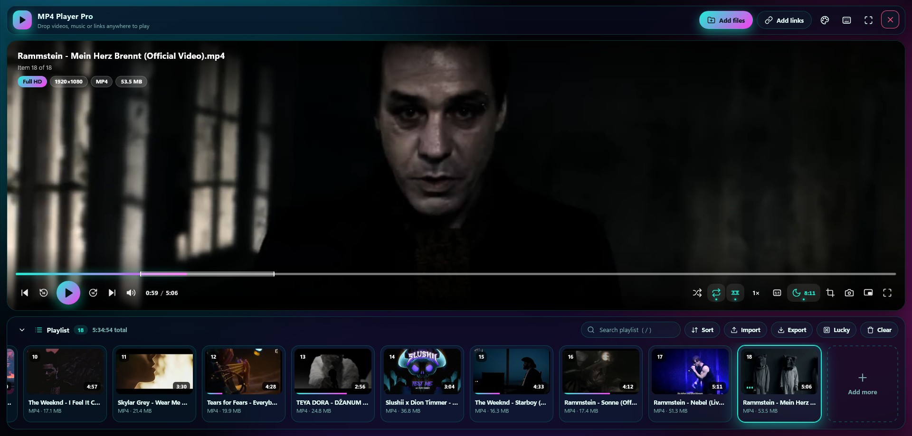
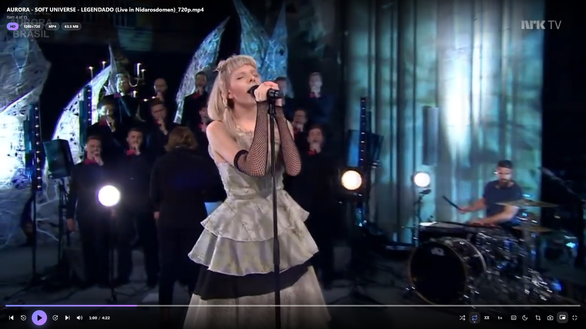
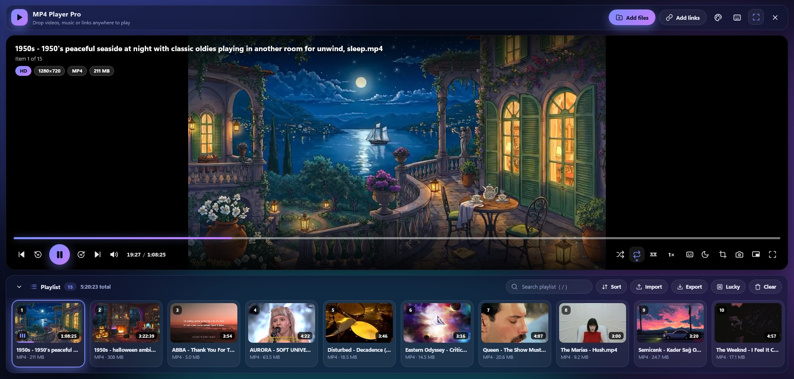
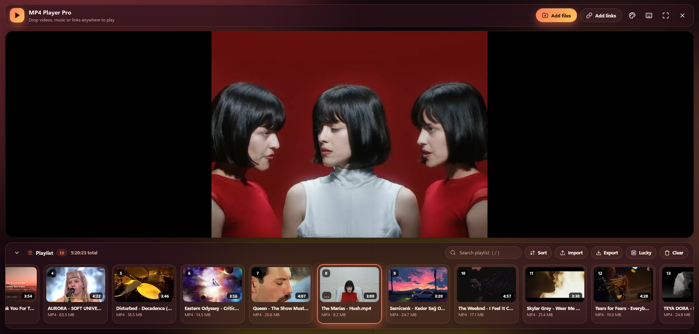

  

  # 🎬 MP4 Player Pro

**MP4 Player Pro** is an ultra-fast, lightweight UserScript that turns your browser into a high-definition media powerhouse. Drag and drop local files or web URLs, load subtitles, switch themes live, and pick up exactly where you left off — no external software required.

---

## ✨ What's New in v1.2.0

- 🎨 **Five live themes** — Midnight Aurora, Neon Cyber, Sunset Ember, Emerald Forest, Daylight (light). Switch from the palette button or press `T`; your choice is remembered.
- ▶️ **Resume playback** — the player remembers where you stopped in each file and offers to continue.
- 💬 **Subtitles** — load `.srt` / `.vtt`, or drop one together with its video. UTF-8 with automatic **Windows-1256 fallback** (great for Persian subtitles).
- 🛠️ **Playback tools** — speed 0.25×–3×, A–B section loop, screenshots, Picture-in-Picture, and fit modes.
- 🖱️ **Gestures** — double-click left/right to skip ±10 s, middle for fullscreen, scroll over the video for volume.
- 🎵 **Audio mode** — cover art and tags read from MP3s, with a live audio visualiser for local audio.
- 📋 **Smarter playlist** — true shuffle, three repeat modes, sorting, `.m3u8` import/export, duplicate detection, and drag-and-drop from anywhere.
- 😴 **Sleep timer** — presets, custom time, "when this item ends", and a gentle volume fade before stopping.
- ⌨️ **Shortcuts** — press `?` to see them all.
- ♿ **Accessibility** — keyboard focus rings, reduced-motion support, and toasts/popups instead of `alert()`/`confirm()`.

For the full list, see the [Releases page](https://github.com/aliashori78/MP4-Player-Pro/releases).

---

## 🚀 Installation

1. **Install a UserScript manager**
   - [Tampermonkey](https://www.tampermonkey.net/) (recommended)
   - [Violentmonkey](https://violentmonkey.github.io/)
   - [Greasemonkey](https://www.greasespot.net/)

2. **Add the script**
   - Download `MP4 Player Pro.js` from the [latest release](https://github.com/aliashori78/MP4-Player-Pro/releases), **or** copy its contents.
   - Open your UserScript manager → **Create new script** → paste → **Save**.

3. **Enjoy** — refresh any tab and the floating launcher will be ready.

---

## 🛠️ Usage

1. **Launch** — click the floating **🎬 MP4 Player Pro** button on the side of the page.
2. **Add media**
   - Drag a video or audio file from your computer into the player, **or**
   - Paste a web URL to a media file, **or**
   - Open a `file:///…mp4` page directly — the player auto-adds and plays it (disable with `autoAddCurrentFile: false` in the `CONFIG` block).
3. **Control** — use the custom control bar (auto-hides after a few seconds) for play/pause, seek, volume, speed, PiP, and fullscreen.
4. **Subtitles** — drop a `.srt`/`.vtt` file onto the player, or onto the same drop as the video.
5. **Close** — click the close icon on the launcher or inside the player.

---

## ⌨️ Keyboard Shortcuts

| Key | Action |
|---|---|
| `Space` | Play / pause |
| `N` / `P` | Next / previous item |
| `←` / `→` | Seek ±5 s |
| `↑` / `↓` | Volume up / down |
| `M` | Mute |
| `F` | Fullscreen |
| `T` | Cycle theme |
| `H` | Toggle shuffle |
| `R` | Cycle repeat mode |
| `?` | Show all shortcuts |

> Shortcuts are disabled while you type in a search box, link input, or any editable field.

---

## 🌐 Compatibility & Notes

- **Formats:** `.mp4` is fully supported. `.webm`, `.mkv`, `.mov`, `.mp3` and others are matched by the script, but **actual playback depends on the browser's built-in decoders** — Chrome, for example, does not natively decode most `.mkv` or `.mov` files. If a format won't play, try a different browser or convert the file.
- **`file://` pages:** the player adds and plays the current file automatically (see `autoAddCurrentFile` in `CONFIG`). Browsers restrict `localStorage`, `fetch()`, and canvas access on `file://`; the player degrades gracefully, but theme/resume persistence may not survive in every browser.
- **Audio visualiser:** works for **local audio only** — remote audio routed through the browser's audio analyser can go silent due to CORS.
- **Fonts:** uses the system font stack, because web fonts can't load reliably on `file://` pages.

---

## 📸 Screenshots

  

  <table>
    <tr>
      <td></td>
      <td></td>
      <td></td>
    </tr>
  </table>

---

## 📜 License

Licensed under the **GNU AGPLv3** — see the script header for details.

## 👤 Author

**Ali Ashori** — 🌐 [i-ali.ir](https://i-ali.ir/) · 🐙 [@AliAshori78](https://github.com/AliAshori78)  
📧 Suggestions and bug reports are welcome via [Issues](https://github.com/aliashori78/MP4-Player-Pro/issues).
